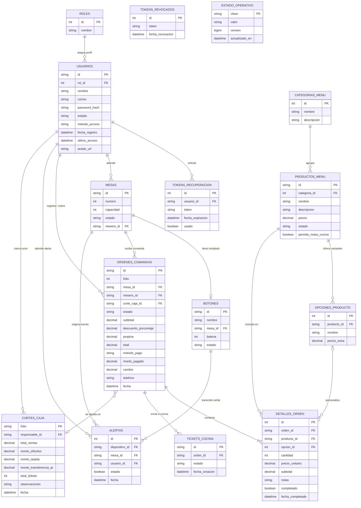

# ¡Hola, Café! – Sistema de Control de Comandas y Monitoreo de Mesas

Aplicación web full-stack para la gestión integral de cafeterías y restaurantes: control de comandas, monitoreo de mesas con botones de llamado IoT, pantalla de cocina (KDS), facturación/caja y comunicación multicanal (correo electrónico, SMS y WhatsApp).

---

## Datos del Equipo
* **Equipo:** 9
* **Integrantes:** Martínez Villalobos Dante, Luna Cenobio Sarai y Ortíz Peréz Gael Fernando
* **Materia:** Programación Web

---

## Tecnologías Utilizadas

* **Backend:** Java 17+, Spring Boot 3.3.x, Spring Security, Flyway, JWT, Twilio SDK, JavaMailSender.
* **Base de Datos:** MySQL
* **Frontend:** React 19, TypeScript, Vite, Tailwind CSS, Lucide Icons.
* **Control de Versiones y Gestión:** Git, GitHub, GitHub Projects.
* **Pruebas de API:** Bruno CLI / GUI.
* **Diseño:** Figma.

---

## Credenciales 

| Rol | Correo Electrónico | Contraseña | Nivel de Acceso |
| :--- | :--- | :--- | :--- |
| **Administrador** | `admin@holacafe.com` | `HolaCafe#2026` | Acceso total, gestión de usuarios, catálogo, cortes y métricas |
| **Mesero** | `gortiz@holacafe.com` | `HolaCafe#2026` | Comandero, asignación de mesas y atención de alertas |
| **Cocinero** | `cocina@holacafe.com` | `HolaCafe#2026` | Pantalla de producción y marcado de platillos |


---

## Modelo Entidad-Relación (Base de Datos MySQL)

El modelo cuenta con **15 tablas normalizadas**, incluyendo la relación de muchos a muchos ($N:M$) entre órdenes y productos resuelta a través de la tabla `DETALLES_ORDEN`.



---

## Instrucciones de Instalación y Ejecución

### 1. Base de Datos (MySQL)
1. Iniciar el servicio de **MySQL** en XAMPP o servicio local.
2. Crear la base de datos vacía:
   ```sql
   CREATE DATABASE holacafe_db CHARACTER SET utf8mb4 COLLATE utf8mb4_unicode_ci;
   ```
   *(Las tablas y los datos de prueba son creados automáticamente por Flyway al iniciar el backend).*
3. El script de respaldo SQL está disponible en: `db/respaldo_holacafe.sql`.

### 2. Backend (Spring Boot)
```bash
cd backend
# Compilar y arrancar la aplicación
mvn spring-boot:run
```
La API estará disponible en: `http://localhost:4000/api`

### 3. Frontend (React + Vite)
```bash
cd frontend
npm install
npm run dev
```
La interfaz de usuario estará disponible en: `http://localhost:3000` 

---

## Enlaces del Proyecto
* **Tablero de GitHub Projects:** [Enlace a GitHub Projects](https://github.com/users/sarailunacenobio05-cpu/projects/3)
* **Prototipo Navegable en Figma:** [Enlace a Figma](https://www.figma.com/proto/SpSkMYMPmkKvtXkX2g9LoV/PrograWeb?node-id=42-1047&p=f&t=T4PO96IxY48eLIyl-1&scaling=scale-down&content-scaling=fixed&page-id=0%3A1&starting-point-node-id=42%3A1047&show-proto-sidebar=1)
* **URL Base de la API (Producción VPS):** `https://holacafe.tech/api`
* **URL de la Aplicación (Producción VPS):** [Enlace al sistema](https://holacafe.tech)

---

## Capturas de Pantalla

### Inicio de Sesión


### Mapa de Mesas y Comandero (Mesero)


### Pantalla de Cocina (KDS)


### Panel de Administrador y Botones IoT

